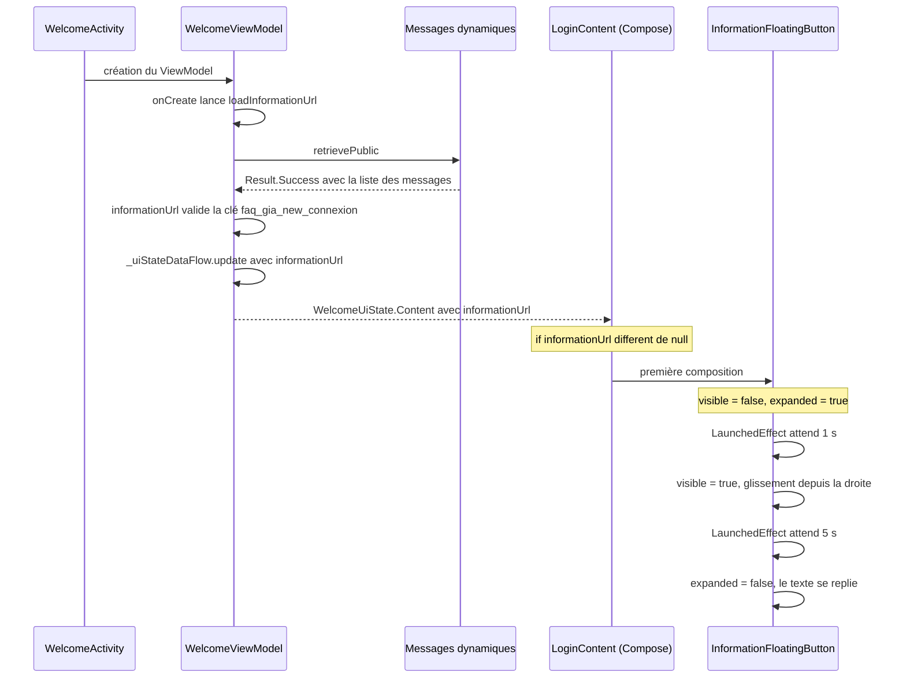
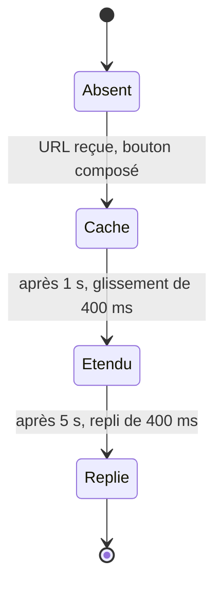
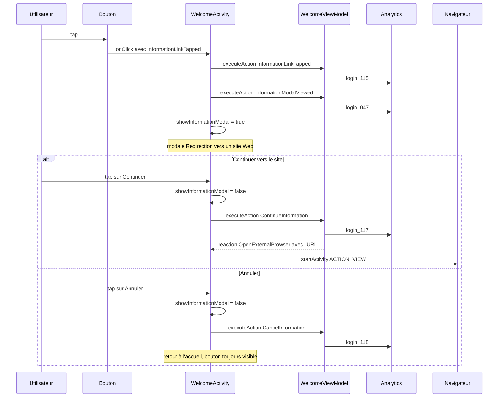

# Comprendre le bouton d'information sur Android

Lecture du code local et des captures des PR le 23 octobre 2026. Cette note explique ce qui se passera une fois la proposition appliquée ; rien n'a été compilé ni testé.

## 1. Le principe en quelques phrases

Le ViewModel partagé (`WelcomeViewModel`) va chercher l'URL dans les messages dynamiques publics et la valide. S'il la trouve, il la place dans l'état de l'écran. L'écran Android affiche alors le bouton, et c'est **lui seul** qui gère son animation et l'ouverture de la modale. Le ViewModel ne s'occupe que de ce qui est mesuré ou partagé : l'URL, les 4 analytics et la réaction « ouvrir le navigateur ».

## 2. Qui fait quoi

| Responsabilité | Où | État |
| --- | --- | --- |
| Récupérer et valider l'URL (`faq_gia_new_connexion`, http ou https) | `WelcomeViewModel` (shared) | Fait |
| Garder l'URL dans l'état (`informationUrl`) | `WelcomeUiStateData`, `WelcomeUiState.Content`, `WelcomeUiStatesProvider` | Fait |
| Compter les 4 analytics | `WelcomeAction` + `BaseViewModel.trackAction` | Fait |
| Demander l'ouverture du navigateur | `WelcomeReaction.OpenExternalBrowser(url)` | Fait |
| Afficher le bouton si l'URL existe | `WelcomeView.kt` | **À faire** |
| Animer le bouton (entrée à 1 s, repli à 5 s) | `WelcomeView.kt` | **À faire** |
| Afficher la modale, brancher Continuer et Annuler | `WelcomeActivity.kt` | **À faire** |
| Ouvrir le navigateur sur la réaction | `WelcomeActivity.kt` | **À faire** |

## 3. Le MVI de cette fonctionnalité

| Élément | Nom | Quand | Effet |
| --- | --- | --- | --- |
| State | `informationUrl: String?` dans `WelcomeUiState.Content` | L'URL est chargée et valide | `null` : pas de bouton. Non nul : bouton affiché. |
| Action | `InformationLinkTapped` | Tap sur le bouton | Analytics `login_115`. Aucune navigation. |
| Action | `InformationModalViewed` | La modale s'affiche | Analytics `login_047` (vue d'écran). |
| Action | `ContinueInformation` | Tap sur « Continuer vers le site » | Analytics `login_117`, puis la réaction ci-dessous. |
| Action | `CancelInformation` | Tap sur « Annuler » | Analytics `login_118`. Aucune navigation. |
| Reaction | `OpenExternalBrowser(url)` | Émise par `ContinueInformation` | L'activité ouvre le navigateur. |

**Ce qui n'est pas dans le MVI partagé** : la modale ouverte ou fermée, ainsi que l'état du bouton (caché, étendu, replié). Ces éléments restent dans l'interface Android, comme le fait déjà la modale « mot de passe oublié ».

Le `when` des actions dans le ViewModel renvoie toujours `null` pour ces quatre actions : il n'y a donc pas de navigation `NavTo`.

## 4. Comment le bouton arrive

Si l'appel échoue, si la clé est absente ou si l'URL est invalide, `informationUrl` reste `null` : **le bouton n'apparaît pas et la connexion n'est pas bloquée**. Le chargement n'est pas retenté tant que le ViewModel n'est pas recréé (garde `informationUrlLoadStarted`).

## 5. Comment l'animation fonctionne

Le bouton est un composable qui contient deux petits états booléens, `visible` et `expanded`, et une coroutine lancée au moment où il entre dans l'écran.

| Instant (t0 = URL reçue) | Ce qui se passe | Mécanisme Compose |
| --- | --- | --- |
| t0 | Le bouton est composé mais invisible (`visible = false`) | `AnimatedVisibility` ne dessine rien |
| t0 + 1,0 s | `visible = true` | `slideInHorizontally` part d'une largeur de bouton à droite de sa place, avec `fadeIn` |
| t0 + 1,4 s | Bouton complet à sa place, icône et deux lignes de texte | Fin des 400 ms |
| t0 + 6,0 s | `expanded = false` | `AnimatedVisibility` interne : `shrinkHorizontally` et `fadeOut` sur le bloc de texte |
| t0 + 6,4 s | Seule l'icône reste ; la pastille devient ronde | Le `Row` s'adapte à son contenu ; le fond arrondi suit la taille |

Les 5 s comptent **après** le début du glissement (le délai de 5 s démarre quand `visible` passe à `true`), donc le repli commence 6 s après la composition du bouton.

Ce qui rend la transition douce : le fond coloré (`clip` et `background`) est posé sur le `Row`, pas sur le texte. Quand le bloc de texte rétrécit, le `Row` rétrécit avec lui et le fond arrondi suit, sans animation de taille supplémentaire à écrire.

Les deux booléens sont sauvegardés (`rememberSaveable`). Après une rotation, le bouton ne rejoue donc pas son glissement : il reste là où il en était. Les minuteurs, eux, repartent (voir les points ouverts).

## 6. Ce qui se passe au tap

Dans `BaseViewModel`, `executeAction` appelle `trackAction`, qui envoie l'analytics des actions de type `ActionAnalytics`, puis `handleAction`. Nos quatre actions ne sont pas à envoi unique : chaque appel envoie son analytics. C'est pourquoi `login_047` est déclenché au moment où la modale s'affiche, et non à chaque recomposition.

La réaction est publiée dans un flux, puis remplacée par `Nothing` 500 ms plus tard (`handleReaction` de `BaseViewModel`). Deux « Continuer » en moins de 500 ms ne produiraient qu'une seule ouverture du navigateur.

## 7. Cas limites

| Cas | Ce qui se passe |
| --- | --- |
| URL absente, invalide ou réseau en échec | Pas de bouton ; l'accueil fonctionne normalement ; message d'erreur dans les logs (Napier). |
| URL qui arrive tard | Le bouton joue sa séquence complète à partir de ce moment. |
| Rotation avant l'arrivée du bouton | Les minuteurs repartent ; le bouton arrive 1 s après la recréation. |
| Rotation pendant que le bouton est visible | Pas de nouveau glissement ; le texte se replie 5 s plus tard s'il était encore étendu. |
| Rotation avec la modale ouverte | La modale se ferme (l'état est dans l'activité, non sauvegardé). Le ViewModel survit. |
| Retour du navigateur | L'accueil est affiché, la modale est déjà fermée, le bouton est replié. |
| Langue de l'appareil | Les textes viennent de `GiaLocalizedString.get()` : EN ou FR selon la langue. |
| Retour système avec la modale ouverte | À vérifier : l'activité bloque le retour, le comportement dépend de `DSDModal`, que je n'ai pas vu. |
