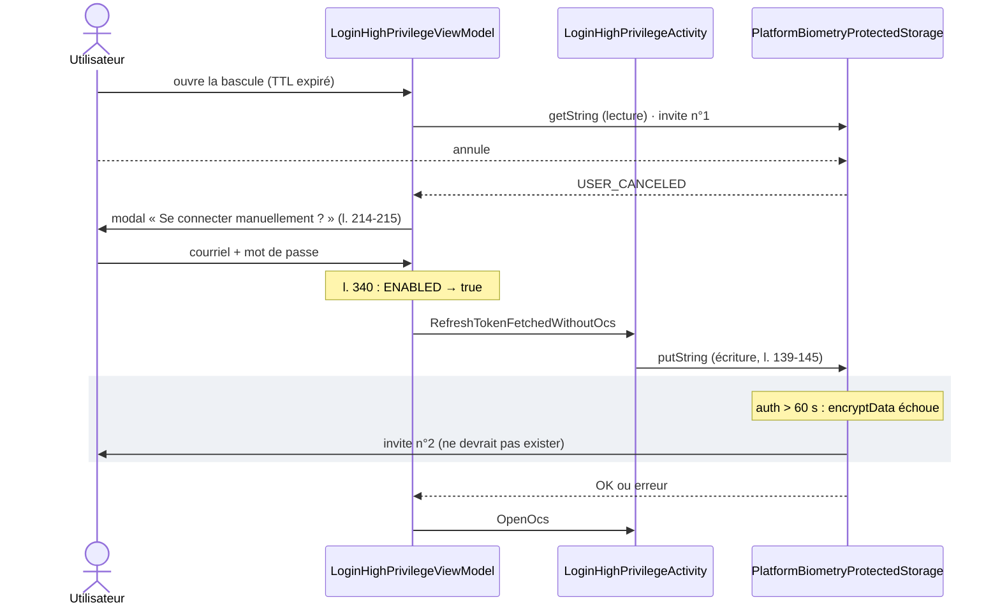
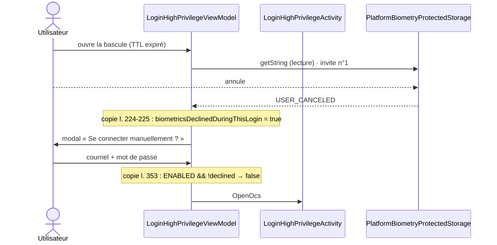

# WRU-26487 — Pourquoi la biométrie est reproposée après le login courriel / mot de passe

*Révisé le 2026-10-27 sur le code à jour du dépôt (1re version obsolète : elle ignorait `USER_CANCELED`).*

## 📁 Fichiers consultés

| # | Fichier | Ce que j'y ai trouvé |
|---|---------|----------------------|
| 1 | ★ `shared/.../feature/authenticate/presentation/login/LoginHighPrivilegeViewModel.kt` | Le portier unique : `isBiometricsEnabledOnApp()` l. 179 et 340 ; `handleWithBiometrics` l. 200-221 ; `MANUAL_LOGIN_RECOVERABLE_ERRORS` l. 369-370 ; sauvegarde l. 278-317 |
| 2 | ★ `shared/.../transverse/domain/platform/PlatformBiometryProtectedStorage.android.kt` | Annulation → `USER_CANCELED` (l. 341-344), autres erreurs → `VERIFICATION_FAILED` (l. 346, 351-355) ; `putString` : essai silencieux puis invite (l. 139-145) ; fenêtre de 60 s (l. 294-296, 406) |
| 3 | ★ `androidApp/.../authentification/login/LoginHighPrivilegeActivity.kt` | `RefreshTokenFetchedWithoutOcs` → `setRefreshTokenToBio()` (l. 74-79, 120-129) |
| 4 | `shared/.../transverse/domain/biometrics/BiometryProtectedStorage.kt` | Enum `BiometryError` : `VERIFICATION_FAILED(5)`, `USER_CANCELED(6)`, `KEY_INVALIDATED(7)` (l. 29-42) |
| 5 | `shared/.../feature/authenticate/data/repository/HighPrivilegeTokenRepository.kt` | `getRefreshTokenFromBiometrics` ne journalise pas `USER_CANCELED` (l. 89-99) ; `setRefreshTokenWithBiometrics` l. 101-124 |
| 6 | `shared/.../presentation/login/LoginReaction.kt`, `LoginAction.kt` | `RefreshTokenFetchedWithoutOcs` (Reaction l. 19), `RedirectLoaded(redirect, ocsUrl)` (Action l. 26) |
| 7 | `shared/.../transverse/domain/platform/PlatformBiometryProtectedStorage.ios.kt` | `LAErrorUserCancel → USER_CANCELED` (l. 276) |
| 8 | `androidApp/.../legacy/AuthSwitcher.kt`, `profile/authentication/ProfileAuthenticationActivity.kt`, `configuration/EnvironmentConfigurationActivity.kt` | Lanceurs de l'écran de login avec `EXTRA_OCS_URL` (AuthSwitcher l. 36-37, Profil l. 55, Config l. 149) ; le toggle du Profil le lance sans OCS |
| 9 | `shared/src/androidUnitTest/.../LoginHighPrivilegeViewModelTest.kt` | 1 222 lignes ; tests existants aux l. 465 et 1048 qui servent de modèle |
| 10 | Captures du ticket (5 images) | Invite → modal manuel → login → 2e invite par-dessus la page de login |
| — | `TTLManager.kt`, `HighPrivilegeAuthManager.swift` | Lus en 1re passe, **non relus** : mention du TTL (20 min) et de l'enchaînement iOS à re-vérifier avant de s'y fier |

**Non vérifiable depuis le code** : le nombre exact d'invites sur appareil, le délai de 60 s en
conditions réelles, la validité du jeton stocké après un nouveau login (configuration Auth0), et
si l'écriture iOS affiche une invite. Rien n'a été compilé ni exécuté.

---

## Graphe 1 — Quel chemin mène à la 2e invite ?

```
  ┌───────────────────────────────────┐
  │  Login courriel + mot de passe OK  │
  │  → RedirectLoaded → fetchTokens    │
  └─────────────────┬─────────────────┘
                    ▼
          refreshToken non vide
                    ▼
   ┌──────────────────────────────────────┐
   │ state : HighPrivilegeWithOcs ?        │
   └───────┬──────────────────────┬───────┘
         NON                     OUI  (cas de la bascule)
   (toggle du Profil)               │
         │              ┌───────────┴─────────────────┐
         │              │ ttlManager.reset()           │
         │              │ isBiometricsEnabledOnApp()   │
         │              │   == ENABLED ?               │
         │              └──────┬───────────────┬──────┘
         │                    NON             OUI
         │                     │               │
         │                OpenOcs ✔           │   ◄── POINT CLÉ n°1
         │              (aucune invite)        │   (aucun test « refus ? »)
         ▼                                     ▼
   RefreshTokenFetchedWithoutOcs  ◄────────────┘
                    ▼
          setRefreshTokenToBio()
                    ▼
        putString() → encryptData
           │                 │
      auth < 60 s       auth > 60 s
           │                 │
      ✔ sans invite     ● ROUGE : 2e invite biométrique
                        ⚠ la page de login est encore à l'écran
                    ▼
        (acceptée ou refusée)
                    ▼
                 OpenOcs
```

Conclusion : le drapeau « activé » est le seul gardien ; il ne sait pas que l'utilisateur vient de
refuser la biométrie.

```kotlin
// LoginHighPrivilegeViewModel.kt (original) l. 335-344
private fun handleRedirectLoadedAuthWithRefreshToken(refreshToken: String) {
    when (state) {
        is LoginInitState.HighPrivilegeWithOcs -> {
            ttlManager.reset()
            if (biometricsRepository.isBiometricsEnabledOnApp()) {                                  // ◄── POINT CLÉ n°1 (l. 340)
                refreshTokenFetchedReaction(refreshToken = refreshToken, url = resolvedOcsUrl)     // → 2e invite
            } else {
                handleReaction(LoginReaction.OpenOcs(resolvedOcsUrl))                               // → aucune invite
            }
        }
```

**Point clé n°1** : `ENABLED` veut dire « activé un jour », pas « un jeton valide est stocké » ni
« l'utilisateur n'a pas refusé à l'instant ».

---

## Graphe 2 — Pourquoi l'invite apparaît-elle malgré le login tout juste fait ?

```
  Dernière authentification biométrique : invite de LECTURE (annulée)
                    │
                    │   ← l'utilisateur tape courriel + mot de passe
                    │      (plus de 60 s en pratique)
                    ▼
   ┌─────────────────────────────────────────────┐
   │ Clé Keystore : fenêtre de validité = 60 s    │  BIOMETRY_SESSION_VALIDITY_
   │ (storage l. 294-296 et 406)                  │  TIME_SPAN_SECONDS = 60
   └───────────────────────┬─────────────────────┘
                           ▼
      encryptData() échoue (exception, storage l. 142)
                           ▼
      catch → promptBiometry()      ● ROUGE : invite
```

Conclusion : le login par mot de passe n'authentifie pas la **clé Keystore** ; seule une
authentification biométrique récente le fait.

```kotlin
// PlatformBiometryProtectedStorage.android.kt l. 139-155
return try {
    encryptData(key, value, securityPair)                      // échoue si auth > 60 s
    BiometryProtectedStorage.BiometryError.NONE
} catch (e: Exception) {
    val promptError = promptBiometry(contextType, contextReference)   // ◄── POINT CLÉ n°2 : l'invite (l. 145)
    if (promptError == BiometryProtectedStorage.BiometryError.NONE) {
        retryPutStringAfterPrompt(key, value, securityPair)
    } else {
        promptError
    }
}
```

**Point clé n°2** : cette invite est légitime quand il faut vraiment stocker un jeton. Elle est
superflue quand l'utilisateur a annulé la biométrie à l'instant et que le jeton stocké est intact.

---

## Graphe 3 — Quelle erreur la 1re invite renvoie-t-elle, et que fait-on ensuite ?

```
        promptBiometry() — callback (storage l. 338-356)
                           │
     ┌─────────────────────┼──────────────────────────┐
  ERROR_USER_CANCELED   onAuthenticationError     onAuthenticationFailed
  ERROR_NEGATIVE_BUTTON  (autres codes)           (empreinte non reconnue)
  ERROR_CANCELED              │                          │
        │                     ▼                          ▼
        ▼             VERIFICATION_FAILED       VERIFICATION_FAILED
   USER_CANCELED
        │                     │                          │
        └─────────────┬───────┴──────────────────────────┘
                      ▼
   VM l. 214 : error ∈ MANUAL_LOGIN_RECOVERABLE_ERRORS ?
                      │
              OUI → modal « Se connecter manuellement ? »
                      │
          ┌───────────┴────────────────────────────┐
   USER_CANCELED / VERIFICATION_FAILED      INVALID_STORAGE / KEY_INVALIDATED
   jeton stocké INTACT                      jeton stocké INUTILISABLE
          │                                        │
   après login : réécriture inutile         après login : réécriture NÉCESSAIRE
   ● ROUGE aujourd'hui : invite quand même   ✔ invite voulue
```

Conclusion : la 2e invite est un défaut pour les deux erreurs du bloc de gauche, et un besoin pour
celles de droite ; le correctif ne vise que le bloc de gauche.

```kotlin
// LoginHighPrivilegeViewModel.kt (original) l. 213-219 et 362-371
onFailure = { exc ->
    if (exc is BiometricsException && exc.error in MANUAL_LOGIN_RECOVERABLE_ERRORS) {   // l. 214
        updateManualConnectionModal(true)                                              // l. 215 : rien n'est mémorisé
    } else {
        setCompoundError("Can't fetch refresh token with biometrics: $exc")
    }
}
...
private val MANUAL_LOGIN_RECOVERABLE_ERRORS =
    setOf(USER_CANCELED, VERIFICATION_FAILED, INVALID_STORAGE, KEY_INVALIDATED)        // ◄── POINT CLÉ n°3 (l. 369-370)
```

**Point clé n°3** : l'annulation est maintenant `USER_CANCELED`. Un correctif qui testerait
uniquement `VERIFICATION_FAILED` (ma 1re version) ne corrigerait pas le cas du ticket.

---

## 💥 Les pièges

### Le piège n°1 : « j'ai tapé mon mot de passe » ne remplace pas « j'ai annulé la biométrie »

- **Ce qu'on croit** : après un login manuel, le flux sait que l'utilisateur ne veut pas de biométrie
  à cet instant.
- **Ce qui se passe** : `handleWithBiometrics` affiche le modal sans rien retenir (l. 214-215) ; la
  porte l. 340 ne lit que le drapeau persistant.
- **Conséquence** : annulation → login → nouvelle invite.

### Le piège n°2 : l'invite finale n'est jamais bloquante, donc le bug paraît bénin

Accepter ou refuser mène à `OpenOcs` (VM l. 302 et 313). Le défaut est purement d'expérience
utilisateur, d'où le ticket « ne doit pas s'afficher à cet endroit ».

### Le piège n°3 : la même invite est parfois nécessaire

| | Annulation / échec d'invite | Stockage invalide / clé périmée / jeton refusé |
|---|---|---|
| Erreurs | `USER_CANCELED`, `VERIFICATION_FAILED` | `INVALID_STORAGE`, `KEY_INVALIDATED`, `Unauthorized` |
| Jeton stocké | ✅ intact | ❌ inutilisable (vidé ou refusé) |
| Réécriture après login manuel | superflue | **nécessaire** |
| Invite après le login | ❌ à supprimer | ✅ à garder |
| Si on supprimait aussi celle-ci | — | boucle : biométrie activée, stockage vide, échec à chaque lancement |

### Le piège n°4 : une version du correctif qui ne teste que `VERIFICATION_FAILED`

Elle passerait les tests qui simulent `VERIFICATION_FAILED` (comme le test existant l. 465) et
échouerait sur appareil, car le bouton Annuler renvoie `USER_CANCELED`.

---

## Tableau de vérité — que se passe-t-il après le login manuel ?

| Scénario | Invite après le login (avant) | Invite après le login (corrigé) | Voulu ? |
|---|---|---|---|
| A. Biométrie désactivée, ouverture OCS | Non | Non | ✅ |
| B. Biométrie activée, 1re invite **annulée** (`USER_CANCELED`, ticket) | Oui | **Non** | ✅ corrigé |
| B'. Empreinte refusée / erreur d'invite (`VERIFICATION_FAILED`) | Oui | **Non** | ✅ corrigé |
| C. Jeton refusé 401/403 (`Unauthorized`) | Oui | Oui | ✅ voulu |
| D. Stockage vide (`INVALID_STORAGE`) | Oui | Oui | ✅ voulu |
| D'. Clé périmée (`KEY_INVALIDATED`) | Oui | Oui | ✅ voulu |
| E. Activation par le toggle du Profil | Oui | Oui | ✅ voulu |

Sur sept scénarios, deux (B et B') changent ; les cinq autres restent identiques.

---

## 🎬 Séquences : avant / après

### Avant



### Après



Conclusion : le correctif retire l'écriture (et donc l'invite) uniquement quand l'utilisateur a
annulé ou échoué l'invite de lecture.

---

## 🔑 Qui déclenche l'écran de login et à quel moment ?

| Acteur | Déclenché par | Condition exacte (telle qu'écrite) | Fichier:ligne | Statut |
|---|---|---|---|---|
| Login avec OCS (bascule) | Action (bouton) | `AuthState.AUTH_V2 -> LoginHighPrivilegeActivity… putExtra(EXTRA_OCS_URL, ocsUrl)` | `AuthSwitcher.kt` l. 36-37 | vérifié sur disque |
| Login avec OCS (modifier profil) | Action | `putExtra(EXTRA_OCS_URL, reaction.url)` | `ProfileAuthenticationActivity.kt` l. 55 | vérifié sur disque |
| Login avec OCS (écran de config) | Action | `putExtra(EXTRA_OCS_URL, urls[…])` | `EnvironmentConfigurationActivity.kt` l. 149 | vérifié sur disque |
| Login sans OCS (toggle) | Action | `FetchHighPrivTokens` | `ProfileAuthenticationActivity.kt` | vu en 1re passe, non relu |
| `GetRefreshTokenWithBiometrics` | État | `HighPrivilegeWithOcs && ttlManager.isExpired() && isBiometricsEnabledOnApp()` | VM l. 177-184 | vérifié sur disque |
| `SaveRefreshTokenWithBiometrics` | Réaction | `RefreshTokenFetchedWithoutOcs` ou `OpenOcsWithSessionTransfer` | Activity l. 74-82 | vérifié sur disque |

`grep` : 7 appels à `LoginHighPrivilegeActivity.newIntent` dans `androidApp` ; seuls les flux avec
OCS passent par `handleWithBiometrics`, donc le champ ajouté n'est jamais posé dans le flux du
toggle.

---

## 🎬 Trace d'états — `biometricsDeclinedDuringThisLogin`

**Niveau** : propriété du `LoginHighPrivilegeViewModel` (portée : un écran de login ; durée de vie :
celle du ViewModel). **Posé** : copie l. 225. **Libéré** : jamais explicitement, il disparaît avec le
ViewModel. **Lu** : copie l. 353 uniquement.

| # | Événement | `declined` | `isBiometricsEnabledOnApp()` | Effet visible |
|---|---|---|---|---|
| **Ordre normal (ticket)** | | | | |
| 1 | Ouverture, TTL expiré | false | ENABLED | invite de lecture |
| 2 | Annulation (`USER_CANCELED`) | **true** | ENABLED | modal manuel |
| 3 | Login manuel OK | true | ENABLED | `OpenOcs`, aucune invite |
| **Empreinte réussie** | | | | |
| 1 | Invite de lecture réussie | false | ENABLED | transfert de session, pas de login manuel |
| **Jeton refusé (401/403)** | | | | |
| 1 | Lecture OK, `fetchTokens` → `Unauthorized` (VM l. 257-260) | false | ENABLED | modal manuel |
| 2 | Login manuel OK | false | ENABLED | invite d'écriture (voulue) |
| **Clé périmée / stockage vide** | | | | |
| 1 | `KEY_INVALIDATED` ou `INVALID_STORAGE` | false | ENABLED | modal manuel |
| 2 | Login manuel OK | false | ENABLED | invite d'écriture (voulue) |
| **Doublon : deux annulations de suite** | | | | |
| 1-2 | Annulation, modal « Annuler », nouvelle tentative dans le même écran | true | ENABLED | pas d'invite après le login (le champ reste vrai) |
| **Arrière-plan / mort de processus** | | | | |
| 1 | Processus tué avant le login manuel | perdu | ENABLED | au retour, nouvelle invite de lecture ; comportement actuel |
| **Exception** | | | | |
| 1 | Erreur biométrique hors `MANUAL_LOGIN_RECOVERABLE_ERRORS` | false | ENABLED | erreur technique (VM l. 217), inchangé |

---

## ✅ Tableau d'état du correctif

| Problème | Statut |
|---|---|
| 💥 Piège n°1 — 2e invite après annulation | ✅ Résolu (scénarios B et B') |
| 💥 Piège n°3 — invite voulue après jeton refusé / stockage invalide / clé périmée | ✅ Conservée volontairement |
| 💥 Piège n°4 — test limité à `VERIFICATION_FAILED` | ✅ Évité : le sous-ensemble inclut `USER_CANCELED` |
| Jeton stocké encore valable après un nouveau login | ⚠️ Hypothèse ; si faux (rotation Auth0), le jeton stocké serait refusé au lancement suivant et on retomberait sur le modal manuel |
| iOS : l'écriture affiche-t-elle une invite ? | ⚠️ Non vérifié ; le correctif est neutre si elle n'en affiche pas |
| Log « prompt cancelled » (VM l. 308) | ⚠️ Teste `VERIFICATION_FAILED` au lieu de `USER_CANCELED` ; cosmétique, hors périmètre |

---

## 🎯 Résumé en une phrase

Après un login manuel, le ViewModel réécrit le jeton avec la biométrie dès que le drapeau « activé »
est vrai, sans savoir que l'utilisateur vient d'annuler (`USER_CANCELED`) l'invite de lecture.
