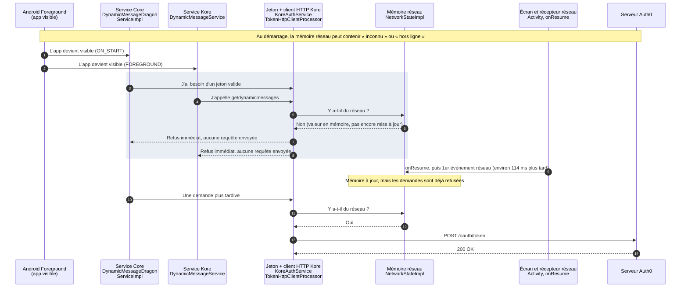
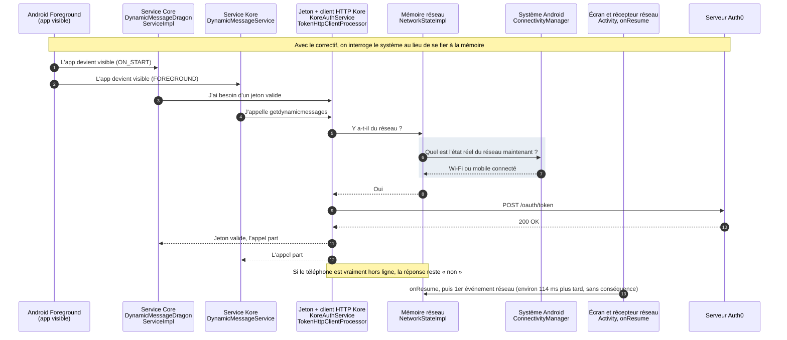

## WRU-27463 — Refus local du jeton Auth0 au démarrage (cache réseau périmé)

### Problème

Au retour au premier plan, des appels réseau sont refusés **localement**, sans qu'aucune requête parte :

```
BaseHttpClientProcessor: No network, path=/oauth/token
Error refreshing low-priv tokens -- null -- TokenError(code=-1, reason=Veuillez réessayer plus tard., httpCode=-1, auth0Code=null)
```

Le réseau est pourtant disponible quelques millisecondes plus tard. Dans les logs analysés : 11 refus `/oauth/token` pour 11 erreurs (log A), 31 pour 31 (log B, dont une partie réellement hors ligne).

### Cause

`TokenHttpClientProcessor` (l.36-41) et `DragonHttpClientProcessor` (l.42-44) appellent `noNetwork()`, donc `NetworkStateImpl.hasNetworkAccess()`. Cette méthode lisait uniquement le **cache** de `BaseNetworkState`.

Le cache est lu à la construction, puis mis à jour par l'observable de SCRATCH, alimenté par un récepteur réseau enregistré à `onResume` (`BaseAppCompatActivity`) et retiré à `onPause`. Un changement réseau survenu pendant que l'app n'est pas affichée n'est donc vu qu'**après** `ON_START`, environ 114 ms plus tard dans les logs (123 ms et 37 ms dans d'autres épisodes). Les services qui démarrent à `ON_START` lisent un cache périmé.

### Changement

`androidApp/.../kore/info/legacy/NetworkStateImpl.kt` (+15 lignes) : `hasNetworkAccess()` lit l'état réel du système au moment de l'appel, avec repli sur le cache si le système renvoie `null` (type de connexion non géré par SCRATCH, comme le recommande la javadoc de `ConnectivityServiceImpl`).

```kotlin
override fun hasNetworkAccess(): Boolean {
    val cached = super.connectionType()
    val live = connectivityService.connectionType
    val current = if (live != null) connectionType(live) else cached
    if (cached != current) {
        Timber.d("Network check: cached=%s live=%s", cached, current)
    }
    return current.hasNetworkAccess()
}
```

- `connectionType()` et `connectionTypeStateFlow` ne changent pas.
- Le journal `Network check` n'apparaît que si le cache et le système divergent : il montrera la valeur du cache au moment du refus.
- 7 tests ajoutés dans `NetworkStateImplTest` : lecture directe WIFI / MOBILE / ETHERNET avec cache hors ligne ou inconnu, hors ligne réel, repli quand la lecture renvoie `null`, changements successifs.

### Avant / après

<details>
<summary>Avant le correctif</summary>



</details>

<details>
<summary>Après le correctif</summary>



</details>

Pile du log A : six de ces demandes de jeton passent par `runBlocking` (`KoreAuthService.getAccessTokenV2`) sur le thread principal. Ce point n'est **pas** traité ici.

### Ce que la PR ne règle pas

- **Téléphone réellement hors ligne** au démarrage : la lecture directe répond aussi « pas de réseau », et rien ne relance les appels au retour du réseau.
- **Thread principal bloqué** pendant un vrai renouvellement du jeton (`runBlocking`).
- **Déconnexions Auth0** : aucune trace (401, 403, `invalid_grant`, `localLogout`) dans les logs analysés. Cette erreur donne `FAILED`, pas `UNAUTHORIZED`.

### Points d'attention pour la revue

- `hasNetworkAccess()` est aussi appelé par `KoreServices.start()` (l.54), `GiaRepository` (l.107), `AjustoDashboardRepository` (l.87) et `AjustoSummaryShimImpl` (l.36, l.53). Au démarrage, `dynamicMessageService.refresh()` peut partir plus tôt dans `KoreServices.start()` : vérifier qu'il n'y a pas de **refresh en double** (`getdynamicmessages`).
- La lecture directe passe par `getActiveNetworkInfo()` (déjà utilisé par SCRATCH). Coût par appel non mesuré.

### Comment tester

1. Build debug (le journal Timber n'est actif que dans ce cas).
2. App au premier plan, mode avion activé, puis Home.
3. Désactiver le mode avion, attendre le retour du réseau, rouvrir l'app (répéter 5 à 10 fois : la fenêtre est courte).
4. Filtre Logcat : `No network, path|Network check|Error refreshing low-priv|New connection type`.

Attendu : une ligne `Network check: cached=NO_INTERNET live=WIFI` (ou `MOBILE`), plus aucun `No network, path=/oauth/token`, puis un `POST` suivi d'un `200`. En mode avion réel, les refus restent (comportement correct).

### État de la validation

- [ ] Compilation
- [ ] `NetworkStateImplTest` exécuté
- [ ] Reproduction avant correctif (journal `cached` / `live` observé)
- [ ] Même scénario après correctif sans refus
- [ ] Pas de refresh en double au démarrage

Analyse complète, preuves et comparaison des versions : `analyse/refresh-token-demarrage/v3/`.
